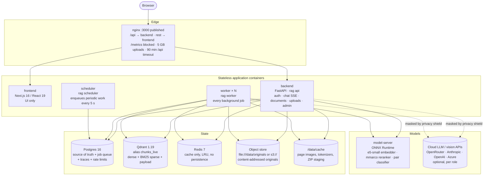
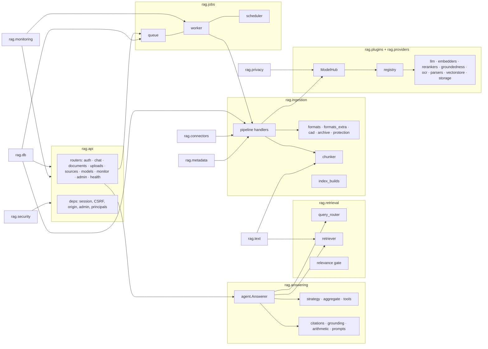
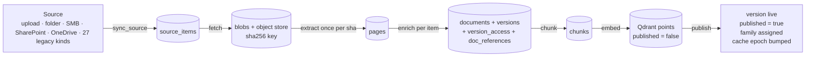
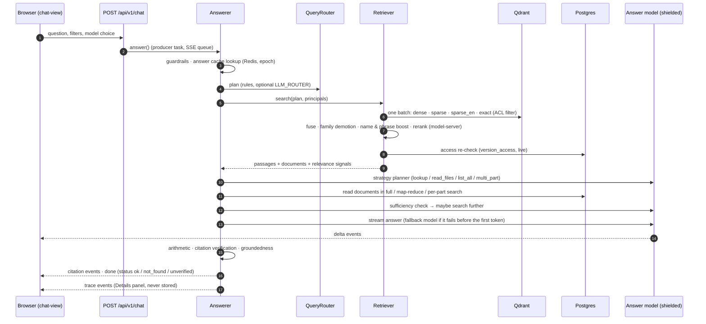
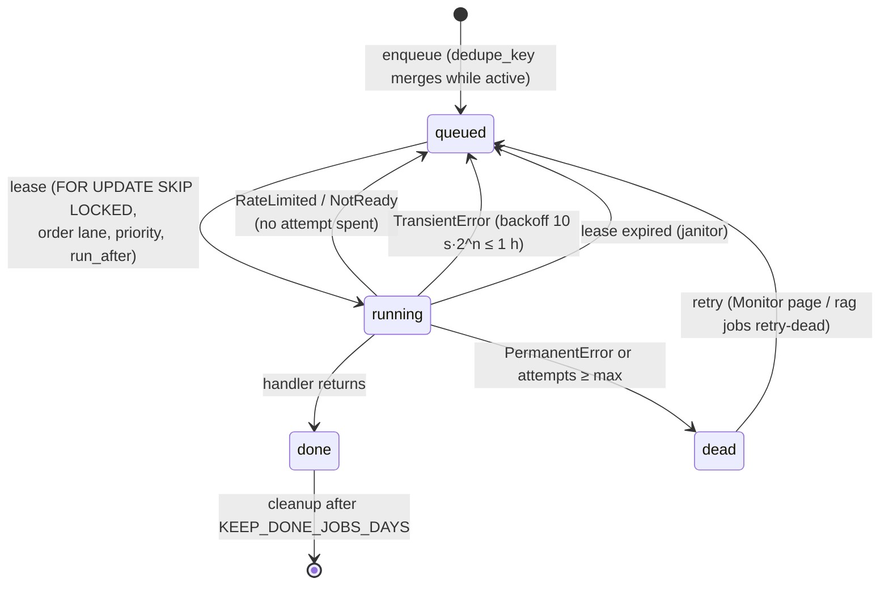
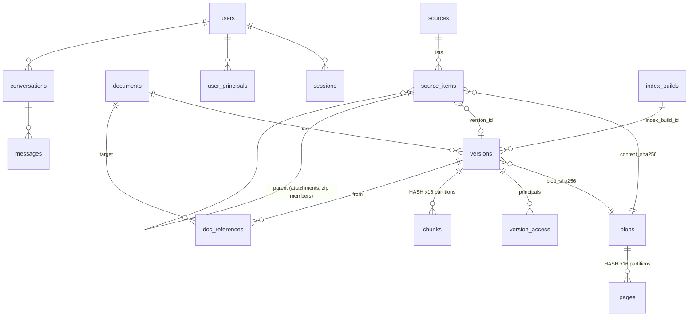

# Architecture

> Checked against the code on 2026-10-23. Every statement here was traced to a file. The file-by-file reference is
> [codebase-map.md](codebase-map.md), step-by-step data flows are in [data-flows.md](data-flows.md), unused code is listed in
> [dead-code.md](dead-code.md), and what to improve next is in [recommendations.md](recommendations.md).

## 1. The system at a glance



| Service | Command | What it does | Keeps state? |
|---|---|---|---|
| `nginx` | nginx 1.27 | The only published port (`WEB_PORT`, 3000). Sends `/api/` to the backend with buffering off, so answers and uploads stream. Everything else goes to the frontend. Blocks `/metrics` and adds security headers. | no |
| `frontend` | Next.js standalone server | Serves the UI. The browser calls `/api/v1/...` itself, with the session cookie and an `X-CSRF-Token` header. | no |
| `backend` | `rag db upgrade && rag api --workers N` | Applies migrations, then runs the FastAPI app (`rag.api.app:create_app`) on uvicorn. | no |
| `worker` | `rag worker` | Leases jobs from the Postgres queue and runs every handler: ingestion, permissions, deletions, housekeeping and evaluation. Scale it with `WORKER_REPLICAS` and `WORKER_CONCURRENCY`. | no |
| `scheduler` | `rag scheduler` | Every 5 s, enqueues the periodic jobs that are due, source syncs and Entra principal syncs. It does no work itself. | no |
| `postgres` | postgres:16-alpine | The truth: documents, versions, pages, chunks, ACLs, users, conversations, the job queue, traces, metrics, audit. | volume `pgdata` |
| `qdrant` | qdrant v1.19.2 | The search index. One collection per index build, reached through the alias `chunks_live`. It is a projection of Postgres and can always be rebuilt. | volume `qdrant_data` |
| `redis` | redis:7-alpine | Cache only: query vectors, rerank scores, verified answers, the library "epoch" and stats. Losing it costs speed, not data. | none |
| `model-server` | `rag-model-server serve` | Local ONNX models: embeddings, cross-encoder reranking and pair classification (HHEM). Nothing leaves the network. | volume `models` |
| `prometheus`, `grafana` | profile `monitoring` | Optional. They scrape `/metrics` from the backend. | volumes |
| `clamav` | profile `clamav` | Optional virus scan of uploads (`CLAMAV_URL`). | none |

In development (`docker-compose.dev.yml`), Postgres, Qdrant and the model server get small memory limits and localhost
ports. The source in `backend/src/rag` is bind-mounted read-only into the containers. Two worker replicas run (2.2 GB and
2.5 CPU each, concurrency 4), and every paid key except `OPENROUTER_API_KEY` is blanked.

## 2. Code layout



`rag.services.Services` is the object every API request and job receives. It holds `settings`, the `ModelHub`, the Qdrant
`VectorStore`, the `ObjectStore`, the `BM25Analyzer` and the `MetadataExtractor`. It also caches the index builds
(10 s) and the known projects (5 min).

## 3. Ingestion: from a file to searchable chunks

Each stage is a job on the Postgres queue. Every stage is idempotent: a dedupe key stops the same job from being queued
twice while one is active, and each handler can be re-run safely.



| Stage | Lane | Key work | Code |
|---|---|---|---|
| `sync_source` | bulk | Asks the connector for changes since the cursor and upserts `source_items`. A new etag queues `fetch`, an ACL change queues `refresh_acl`, and a deleted item queues `delete_item`. After a complete listing, unseen items are deleted. | `pipeline.sync_source`, `_apply_changes`, `_delete_unseen` |
| `fetch` | interactive (uploads) / bulk | Downloads the bytes and refuses protected files (`Protected: …`). Skips extensions in `SKIP_EXTENSIONS` for non-upload sources. Then detects the format by content, enforces `MAX_FILE_MB`, and stores the blob content-addressed. Queues `extract`, or `enrich` when the sha was already extracted. | `pipeline.fetch`, `protection.detect`, `formats.detect_format` |
| `extract` | same | Runs once per sha256. `parse_document` picks the reader (PDF page router, Office, mail, ZIP, CAD, image OCR, RTF/ODT/XER, legacy Office through LibreOffice). Optionally redacts bank values. Pre-renders CAD previews, turns attachments into child blobs and writes `pages` rows. Then queues `enrich` for every item waiting on this sha. | `pipeline.extract`, `formats.parse_document`, `cad`, `providers/parsers/pdf.py` |
| `enrich` | same | Builds metadata in rule order: source fields, ISO 19650 name, title block, content, filename, path. `LLM_ENRICH` fills the gaps. Document identity is `num:{project}:{doc number}`, corroborated by MinHash; otherwise `item:{id}`. Then it upserts the document and version, derives the ACL, records cross-references, creates child items, releases the previous version and queues `chunk` (or `update_acl` if already live). | `pipeline.enrich`, `metadata/*` |
| `chunk` | same | Structure-aware chunks of ~380 tokens plus a 64-token header and 15% overlap. A chunk never crosses a page. Tables become labelled rows, and drawings get a title-block chunk. | `chunker.Chunker` |
| `embed` | same | Writes a dense vector and a BM25 sparse vector to every write build (live + building). Vectors are reused for identical `content_hash`. The payload carries ACL, family, project, type and text. Leftover chunk numbers are deleted. | `pipeline.embed`, `_dense_vectors` |
| `publish` | same | Marks the version live and the document current, assigns the near-duplicate family and resolves reference targets. Sets `published=true` in Qdrant and bumps the answer-cache epoch. | `pipeline.publish`, `settle_document`, `assign_family` |
| `update_acl`, `refresh_acl`, `delete_item`, `release_version` | **control** | Permission and deletion changes. A released version with no active item has its chunks, vectors, pages, blob and object removed at once (`purge_unused_file`). | `pipeline.*` |

`STAGE_PRIORITY` favours later stages, so documents that have already started finish before new ones begin.

## 4. Answering a question



The details are in [retrieval.md](retrieval.md) and [data-flows.md](data-flows.md#3-a-question).

## 5. The job queue



- Lanes are served strictly in order: `control` (0), then `interactive` (1), then `bulk` (2). A permission change never
  waits behind a bulk import.
- Leases last 300 s and are renewed by a heartbeat. A worker that dies stops renewing, and the `janitor` (every 30 s)
  puts its jobs back.
- Periodic jobs come from `jobs/scheduler.py`. Each is keyed by its time slot (`periodic:<kind>:<slot>`). A slot that
  already has a job row, finished or not, is skipped. This stops the earlier bug where daily jobs ran every few seconds.

| Periodic job | Every | Lane | Does |
|---|---|---|---|
| `janitor` | 30 s | control | Requeues jobs whose lease expired. |
| `monitor_tick` | 30 s | control | Evaluates the alert rules. |
| `resume_stalled` | 2 min | bulk | Re-queues `enrich` for items that were extracted but never enriched. |
| `maintenance` | 1 h | bulk | Manages partitions, retention, expired sessions, old finished jobs and the ZIP staging sweep. |
| `gc_blobs` | 6 h | bulk | Removes unused blobs older than a day (up to 500 per run). |
| `reconcile` | 24 h | bulk | Compares each live or deleted version's point count in Qdrant with Postgres, then repairs it. |
| `sync_source` | `schedule_minutes` per source | bulk | Connector delta sync. |
| `sync_principals`, `sync_site_groups` | `PRINCIPAL_SYNC_MINUTES` | control | Entra groups and SharePoint site groups (Entra mode only). |

## 6. Data model (Postgres, 32 tables, one squashed migration `0001_initial_schema.py`)



| Group | Tables |
|---|---|
| Identity | `users`, `sessions`, `user_principals`, `site_groups`, `audit_log` |
| Content | `sources`, `source_items`, `blobs`, `documents`, `versions`, `version_access`, `pages` (hash ×16), `ocr_cache`, `chunks` (hash ×16), `doc_references` |
| Chat | `conversations`, `messages` |
| Work | `jobs` (+ partial index `ix_jobs_ready`), `provider_cooldowns`, `daily_budgets`, `rate_limits`, `usage_daily` |
| Models and index | `index_builds`, `role_overrides`, `model_switches` |
| Monitoring | `traces`, `spans` (daily partitions), `metric_minutes`, `process_stats`, `alerts` |
| Evaluation | `eval_runs`, `eval_items` |

Postgres is the truth and Qdrant is a projection of it. Each Qdrant point id is the chunk id
(`uuid5(version_id, chunk_no)`), and its payload copies the version's ACL, family, project, type, file name and,
with `STORE_TEXT_IN_INDEX=true`, the chunk text.

## 7. Models and plugins

```mermaid
flowchart LR
    env[.env role lines<br/>LLM_ANSWER=openrouter/anthropic/claude-haiku-5.5] --> roles[config.roles.RoleSpec]
    ui[Models page overrides<br/>role_overrides table] --> hub
    roles --> hub[plugins.hub.ModelHub]
    hub --> reg[plugins.registry<br/>Capability × provider → factory]
    reg --> p1[openai_compat / anthropic / extractive]
    reg --> p2[local embedder / cohere / hashing]
    reg --> p3[local reranker / cohere / lexical]
    reg --> p4[rapidocr / azure_di / mistral / vision]
    reg --> p5[local/pdfium / llamaparse / azure_di / mistral]
    hub --> wrap[ShieldedChat (privacy masking, cloud only)<br/>MeteredChat (usage, cost, inspector trace)]
```

There are 12 roles: `LLM_ANSWER`, `LLM_ANSWER_HARD`, `LLM_ANSWER_FALLBACK`, `LLM_ROUTER`, `LLM_ENRICH`, `VISION`, `CAD_VISION`,
`EMBEDDER`, `RERANKER`, `GROUNDEDNESS`, `PARSER` and `OCR`.

- Admins can switch the chat roles, `VISION`, `CAD_VISION` and `OCR` on the Models page.
- The embedder, the reranker and the parser change only through `.env`. Changing the embedder needs an index rebuild.
- `VISION` falls back to `VISION_FALLBACK` on errors such as 429.

## 8. Caching

| What | Where | Invalidation |
|---|---|---|
| Query embeddings | Redis (`rag:` prefix) | Keyed by model and text. |
| Rerank scores | Redis (`mget`/`mset`) plus process memory | Keyed by model, question and passage hash. |
| Verified answers (`status=ok` only) | Redis JSON, TTL `CACHE_ANSWER_TTL_S` (24 h) | The key includes question, principals, filters, model, prompt, history and the **library epoch**. The epoch is bumped on publish, delete, ACL change, project change and index activation. |
| Page images | `/data/cache/pages/<sha[:2]>/<sha>-<page>-<scale>.png` | Deleted when the blob is purged. |
| OCR results | `ocr_cache` table, keyed by image hash and engine | Kept until the blob is purged. |
| Tokenizers | `/data/cache/tokenizers` | Per model. |

Redis has a 15 s circuit breaker. When it is down, every caller falls back to computing the value or to a Postgres table.

## 9. Frontend

The frontend is Next.js 16 (App Router), React 19, Tailwind and SWR-style hooks (`lib/hooks.ts`).

- **Pages:** chat (`/`, `/c/[id]`), documents (list, plus a viewer with page image, extracted text and highlights),
  sources, models, monitor, lab (retrieval debug), evaluation, users and login.
- **Calls:** every call goes through `lib/api.ts`, which adds the CSRF header and the `/api/v1` prefix.
- **Chat stream:** chat uses `lib/sse.ts`, which sends a POST and reads the server-sent events. `trace` events feed the
  per-answer **Details** panel (`components/chat/details-panel.tsx`) through an in-memory store (`lib/trace-store.ts`).
  Nothing is persisted.

## 10. Where things live on disk

| Path (in containers) | Contents |
|---|---|
| `/data/originals/sha256/<sha[:2]>/<sha[2:4]>/<sha>` | Original files, once per content hash (`OBJECT_STORE_URL=file://…`) |
| `/data/cache/pages/…` | Rendered page PNGs (PDF, Office previews, CAD sheets) |
| `/data/cache/upload-staging/…` (or `UPLOAD_STAGING_DIR`) | Extracted ZIP uploads waiting for the user's selection, swept hourly |
| `/data/eval` | Golden sets (`EVAL_DIR`) |
| `models` volume | ONNX models for the model server |
