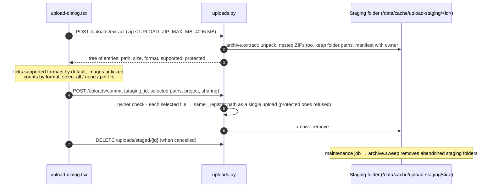
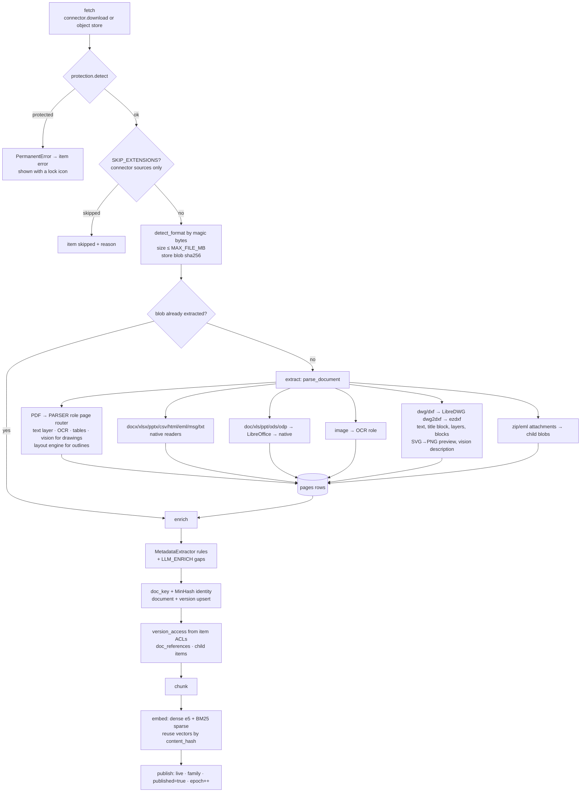
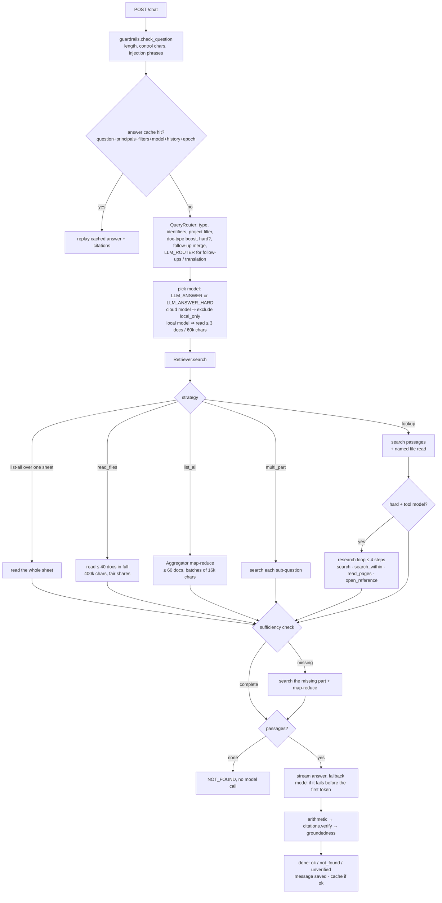
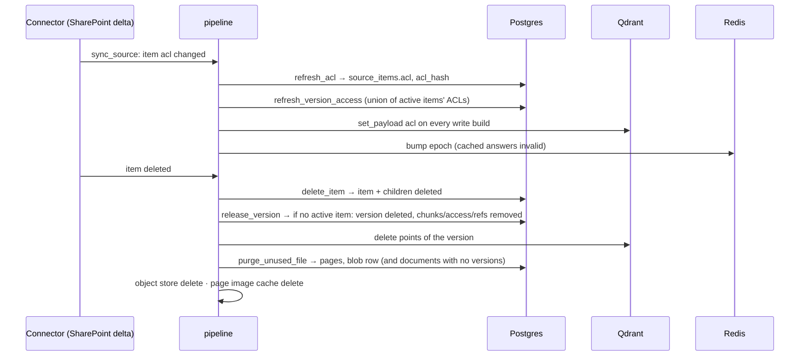
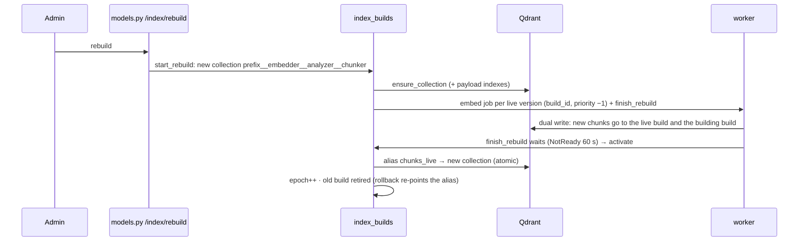

# Data flows

Each flow below follows the data step by step, naming the file and function at every step. It was checked against the
code on 2026-10-23.

## 1. Uploading files

### 1a. Single files (Documents page → Upload)

```mermaid
sequenceDiagram
    autonumber
    participant UI as upload-dialog.tsx
    participant API as uploads.py POST /uploads
    participant PG as Postgres
    participant OS as Object store
    participant W as worker
    UI->>API: multipart file(s), project, sharing (CSRF + session)
    API->>API: rate limit (rate_limits) · size ≤ UPLOAD_MAX_MB · validate_upload (type by content, OOXML bomb limits) · safe_filename · ClamAV if CLAMAV_URL
    API->>API: protection.detect → refuse password-protected PDF / Office / ZIP ("Protected: …")
    API->>OS: put blob sha256/aa/bb/<sha>
    API->>PG: the one shared "Uploads" source (kind=upload) · source_items row in folder Uploads/<project or e-mail><br/>acl = uploader + chosen groups · blobs row
    API->>PG: enqueue fetch (lane interactive, priority 10); a replaced file's old version → release_version (control)
    API-->>UI: item ids
    loop every few seconds
        UI->>API: POST /uploads/status {ids}
        API-->>UI: stage per item (fetch/extract/…/live or error, protected flag)
    end
    W->>PG: lease fetch → extract → enrich → chunk → embed → publish (see section 2)
```

Nothing is blocked by extension on upload. Images, DWG and DXF are accepted like everything else. `SKIP_EXTENSIONS`
applies only to connector sources, and only in `fetch`.

### 1b. A ZIP folder



## 2. One file through the pipeline



The privacy shield applies at two points in this pipeline:

- With `PRIVACY_REDACT_STORED=true`, bank values are removed from page text before it is stored.
- With `PRIVACY_AUTO_LOCAL_ONLY=true`, a document that contains such values is marked `local_only`. The whole document
  then never reaches a cloud model: neither `LLM_ENRICH` nor the answer models see it.

## 3. A question



### Inside `Retriever.search`

1. Get the live build and its embedder, then embed the question. The vector is cached in Redis.
2. Build the filter: `acl ∈ principals`, `published = true`, the project, type, document and source filters, and
   `must_not local_only` when the answer model is in the cloud.
3. Count the visible chunks approximately. If there are at most `EXACT_SEARCH_BELOW` (40,000), the dense leg does an
   exact scan.
4. Send one Qdrant `query_batch` with these legs:
   - dense (top 60)
   - sparse BM25 (top 60)
   - sparse over the English translation, when there is one
   - exact identifiers (top 30, exact=True)
5. Fuse the legs:
   - normalise each leg by its maximum, then weight it by question type (`FUSION_WEIGHTS`);
   - compress exact hits into the 0.6–1.0 band;
   - add +0.08 when the document type matches.
6. Demote near-duplicate family members ×0.6. The representative is the copy that has a project and a doc number.
7. Add the name boost (+1.0) when the question spells a file name.
8. Load the chunk text from Postgres if the payload does not carry it.
9. Add the phrase boost: the share of the question's word pairs found in the chunk, ×0.5, over the top 40.
10. Rerank the top 15 with the cross-encoder. This runs only for questions of 5 words or more without an identifier.
    Scores are cached. The blend is adaptive, between 0.2 and 0.8.
11. The page boost runs here. It is off by default.
12. Re-check access in Postgres for the top max(`CANDIDATE_DOCS`·4, 60) versions: each must be live and have a matching
    `version_access` row.
13. Group the chunks into documents (at most 40).
14. Apply the relevance gate. Dense, sparse, coverage and rerank must **all** be weak to turn the question away. The
    rerank gate (0.02) applies to English only. The other thresholds are 0, so they are off by default.
15. Choose up to 12 passages, at most 3 per document, skipping demoted near-copies. Expand each with its ±1 neighbour
    chunk on the same page and under the same heading.

## 4. Permission change and deletion (control lane)



From the UI, `DELETE /documents/{id}` runs the same removal synchronously (`documents._remove_document`).

## 5. Rebuilding the index (embedder, analyzer or chunker version change)



A rebuild re-embeds the chunk rows that **already exist**. A change to `CHUNKER_VERSION` gives the collection a new name,
but the chunks are not redone. Run `rag reprocess` for that (see [recommendations.md](recommendations.md)).

## 6. Monitoring data

- Every request and job runs inside a `trace` with `span`s (`monitoring/tracing.py`).
- The `Recorder` buffers them and writes them in batches to:
  - `traces` / `spans` (daily partitions, kept `MONITOR_RETENTION_DAYS`);
  - `metric_minutes` (per-minute rollups);
  - `usage_daily` (tokens and cost per user and model);
  - `process_stats` (live counters every 2 s).
- The Monitor page reads them through `/monitor/*` and streams `/monitor/stream`.
- `/metrics` renders Prometheus metrics from the same rollups.
- The per-answer Details panel is separate. It is built from `monitoring/inspector.py` notes, sent as SSE `trace`
  events, and never written anywhere.
